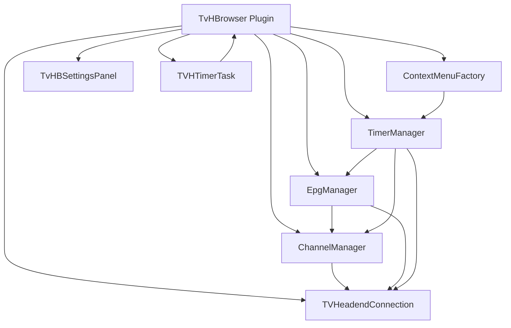

# TvHBrowser Code Documentation (English)

## 1. Project Purpose
TvHBrowser is a TV-Browser plugin that synchronizes scheduling data with TVHeadend.

Core capabilities:
- Connect to a TVHeadend server via HTTP/HTTPS and Basic Auth.
- Load EPG data from TVHeadend.
- Create, delete, enable, and disable TVHeadend timers.
- Map TV-Browser channels to TVHeadend channels.
- Expose context menu actions in TV-Browser.
- Persist channel mappings.

## 2. Runtime Architecture

Main startup flow:
1. Plugin is constructed and managers are initialized.
2. At TV-Browser startup completion, timer and EPG lists are loaded.
3. A periodic background task triggers timer refresh.
4. Context-menu actions call timer operations.

## 3. Package Overview
All production classes are in package tvhbrowser.

### 3.1 Core Plugin and Integration
- TvHBrowser
- TVHeadendConnection
- TVHTimerTask

### 3.2 Domain and Matching Model
- TimerEpgInterface
- Timer
- EpgProgram
- TVHeadendChannel

### 3.3 Application Services
- ChannelManager
- EpgManager
- TimerManager

### 3.4 UI Components
- TvHBSettingsPanel
- GeneralPanel
- ChannelPanel
- TimerPanel
- ContextMenuFactory

### 3.5 Tests
- AppTest

## 4. Class-by-Class Documentation

## TvHBrowser
Role:
- Main plugin entry point and dependency container.
- Owns settings, managers, connection, and context menu wiring.

Key responsibilities:
- TV-Browser plugin lifecycle integration.
- Settings read/write and typed getter/setter helpers.
- Mark/unmark TV-Browser programs.
- Logging and UI message dialogs.
- Startup data loading and periodic refresh start.

Important public methods:
- getSettingsTab(): Creates settings UI.
- getContextMenuActions(Program): Creates program context actions.
- handleTvBrowserStartFinished(): Loads timers/EPG and starts periodic update task.
- updateTimer(): Safe refresh entry, marshals to EDT if needed.
- testTVHConnection(): Checks server connectivity and reports result.
- writeData/readData: Persists/loads channel mappings.

Notes:
- Settings are stored in a single static Properties object.
- Mark icon returned by getMarkIconName() is tvheadend.png.

## TVHeadendConnection
Role:
- HTTP API gateway to TVHeadend.

Key responsibilities:
- Authenticate requests using Basic Auth.
- Fetch channel list, EPG list, and timer lists.
- Mutate DVR entries (create, cancel, enable, disable).

Important public methods:
- testConnection(): Verifies server reachability via /api/serverinfo.
- getChannelList(): Reads /api/channel/list.
- getUpcomingTimerList(), getAllTimerList(), getFinishedTimerList(), getFailedTimerList().
- getEpgList(): Reads /api/epg/events/grid.
- createTimerWithEvent(Integer): Uses /api/dvr/entry/create_by_event.
- deleteTimer(String): Uses /api/dvr/entry/cancel.
- disableTimer(String): Sets enabled=false via /api/idnode/save.
- enableTimer(String): Sets enabled=true via /api/idnode/save.

Internal helpers:
- makeHttpRequest(...): Generic array-fetch helper expecting JSON with entries.
- makeAuthenticatedGetRequest(...): Shared authenticated GET for mutation endpoints.

## TVHTimerTask
Role:
- Background scheduler for periodic timer updates.

Behavior:
- startThread(): Starts java.util.Timer if not running.
- stopThread(): Cancels timer and clears reference.
- Scheduled action: Calls TvHBrowser.updateTimer() every 30 seconds.

## ChannelManager
Role:
- Maintains mapping between TV-Browser channels and TVHeadend channels.

Data structures:
- channelToTVHMap: TVB channel ID -> TVH channel key.
- tvhToChannelMap: TVH channel key -> TVB channel ID.
- tvhChannelMap: TVH key -> TVHeadendChannel object.
- tvbChannelMap: TVB ID -> devplugin.Channel object.

Important public methods:
- importChannelLists(), getTVBrowserChannels(), getTVHeadendChannels().
- mapChannels(...), mapChannelsByName(...), unmapChannelsByName(...).
- getUnmappedTVHChannels().
- getMappedTvhChannel(String), getMappedTvbChannel(String).
- writeData/readData for persistence.

## EpgManager
Role:
- Loads EPG data and matches TV-Browser programs to TVHeadend EPG events.

Data structures:
- epgMap: eventId -> EpgProgram.
- epgDateChannelMap: Date -> (TVH channel UUID -> list of event IDs).

Important public methods:
- loadEpgList(): Rebuilds EPG indexes.
- getEpgProgram(int): Direct lookup by event ID.
- getEpgProgram(Program): Match by date, mapped channel, and text comparison.
- updateEpg(): Alias for reloading EPG list.

## TimerManager
Role:
- Loads timer data, maps timers to TV-Browser programs, and triggers timer operations.

Data structures:
- timerMap: timer UUID -> Timer object.
- timerToProgramMap: timer UUID -> TV-Browser program ID.
- timerDateMap: Date -> (TVH channel key -> timer UUID list).

Important public methods:
- loadTimer(): Loads upcoming timers and builds date/channel indexes.
- mapTimerToProgram(): Matches timers against TV-Browser schedules.
- updateTimer(): Reload + remap pipeline.
- createTimer(Program): Resolves EPG event and creates timer.
- deleteTimer(Program), enableTimer(Program), disableTimer(Program).
- isTimerEnabled(Program): Reads enabled state for UI toggling.
- handleTvDataUpdateFinished(): Reconciles mapped program IDs after TV data updates.
- writeData/readData: Persistence hooks for timer mapping.

Implementation notes:
- Mapping is based on date, channel mapping, start-time tolerance, and text matching.
- Operations guard against missing timer mapping and show user-facing error messages.

## ContextMenuFactory
Role:
- Builds TV-Browser context menus for program actions.

Behavior for createActionMenu(Program):
- If program is marked and on air: show Stop recording.
- If program is marked and not on air: show Delete Timer and a dynamic Enable/Disable Timer action.
- If program is unmarked: show Recording action.
- Always includes Settings action placeholder.

Dynamic enable/disable behavior:
- Reads current timer state through TimerManager.isTimerEnabled(program).
- Displays corresponding label and icon:
  - Enabled timer -> Disable Timer + timer_disabled.png.
  - Disabled timer -> Enable Timer + timer_enabled.png.

## TvHBSettingsPanel
Role:
- Root settings tab containing sub-panels.

Responsibilities:
- Creates a tabbed UI with General, Channels, and Timers tabs.
- Persists settings via GeneralPanel.saveSettings().
- Supplies settings tab icon and title.

## GeneralPanel
Role:
- Configures connection-related plugin settings.

Stored settings:
- fqdn
- port
- timeout
- https
- username
- password

Behavior:
- loadSettings(): Populates UI from plugin settings.
- saveSettings(): Writes current UI values back to plugin settings.
- onClose(): Triggers a connection test.

## ChannelPanel
Role:
- UI for mapping TVHeadend channels to TV-Browser channels.

Capabilities:
- Manual mapping and unmapping.
- Auto-mapping using normalized fuzzy matching score.
- Displays unmapped TVHeadend channels and current assignments.

Key workflow methods:
- mapSelectedRows()
- unmmapSelectedRow()
- autoMapping()
- fillLeftTable()/cleanAndFillLeftTable()

## TimerPanel
Role:
- Placeholder panel for timer settings UI.

Current status:
- Minimal panel with label and extension point for future timer settings.

## TimerEpgInterface
Role:
- Shared abstract base for Timer and EpgProgram matching logic.

Provides:
- Common time fields and episode extraction.
- Abstract accessors for title/subtitle/extracted title in language maps.
- Text comparison helpers and Program-matching algorithm.

Core methods:
- extractEpisodeInfo(): Parses title patterns like "Name (2/10)".
- getProgramTextToCompare(Program)
- getTimerTextToCompare()
- compare(Program): Time-window + text-based + optional episode-number check.

## Timer
Role:
- DTO/model for TVHeadend DVR timer entries.

Data coverage:
- Full DVR scheduling fields, metadata, status fields, and language maps.
- Extends TimerEpgInterface for matching and episode extraction support.

API style:
- JavaBean getters/setters for all mapped JSON properties.
- isEnabled()/setEnabled(boolean) is the authoritative timer state for enable/disable UI.

## EpgProgram
Role:
- DTO/model for TVHeadend EPG events.

Data coverage:
- Event ID, channel metadata, title/subtitle, flags, and timing fields.
- Extends TimerEpgInterface and adapts single-string title/subtitle to language map semantics.

## TVHeadendChannel
Role:
- Minimal DTO for TVHeadend channel list entries.

Fields:
- key: Stable channel UUID/key used for API correlation.
- val: Display name.

## AppTest (test source)
Role:
- Basic JUnit 3 skeleton test.

Current status:
- Contains only a trivial assertTrue(true).
- Serves as a template and build sanity check, not a behavioral test suite.

## 5. Timer Lifecycle and State Model
Timer states relevant to this plugin:
- Created: via createTimerWithEvent.
- Enabled: enabled=true in DVR entry.
- Disabled: enabled=false in DVR entry (idnode/save).
- Deleted/Canceled: removed or canceled via dvr/entry/cancel.

UI implications:
- Context menu actions derive state from timer mapping and current timer model.
- Enable/Disable action text and icon switch according to current timer.enabled value.

## 6. Persistence and Data Synchronization
Persisted mappings:
- Channel mappings are serialized via ChannelManager.writeData/readData.
- Timer mapping persistence hooks exist in TimerManager but are currently not used by TvHBrowser writeData/readData.

Periodic sync:
- TVHTimerTask runs every 30 seconds and calls updateTimer().

## 7. Error Handling Strategy
- User-visible errors: JOptionPane dialogs via showError/showWarning/showInfo.
- Operational traces: append-only log in system temp folder (tvhbrowser.log).
- Network/API failures: caught and reported with endpoint and exception message.

## 8. Known Technical Debt and Improvement Opportunities
- Several UI labels and comments are still mixed-language and can be standardized to English.
- Some classes include unused imports and legacy comments.
- Test coverage is currently minimal; add unit/integration tests for mapping and state transitions.
- Consider extracting repeated setting retrieval into small connection-config objects.

## 9. Suggested Test Coverage Additions
- Timer enable/disable roundtrip state validation.
- Channel auto-mapping score behavior and threshold checks.
- Timer-to-program matching edge cases around start-time tolerance and episode numbers.
- Connection error handling and malformed payload scenarios.
